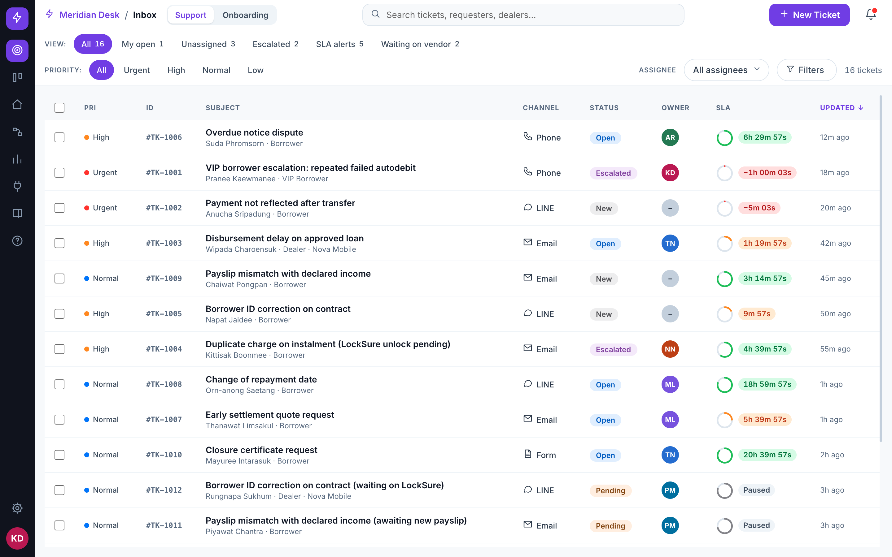
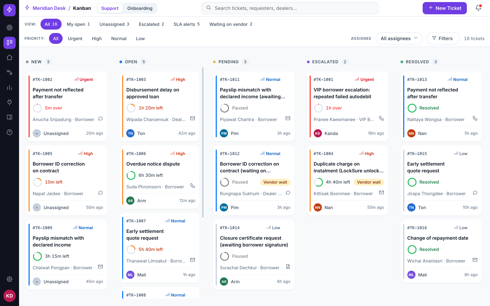
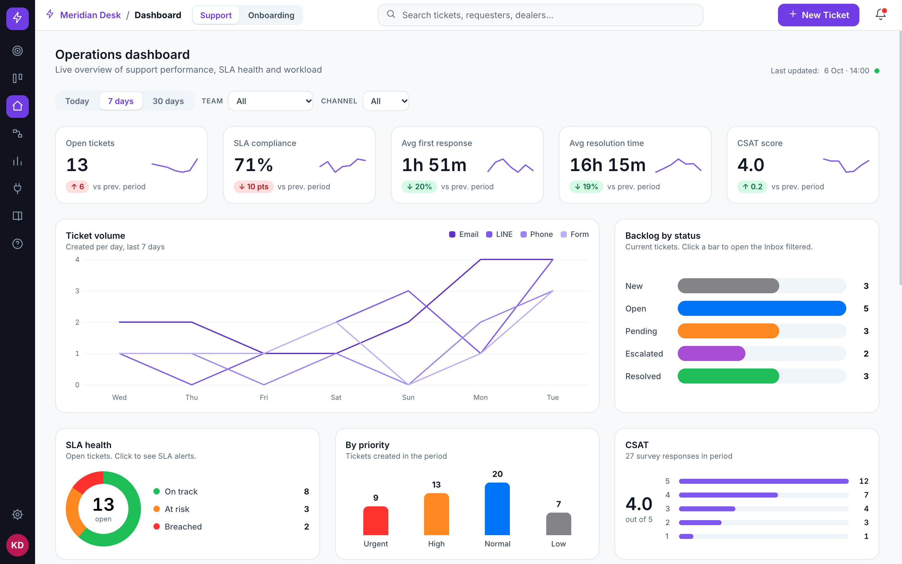
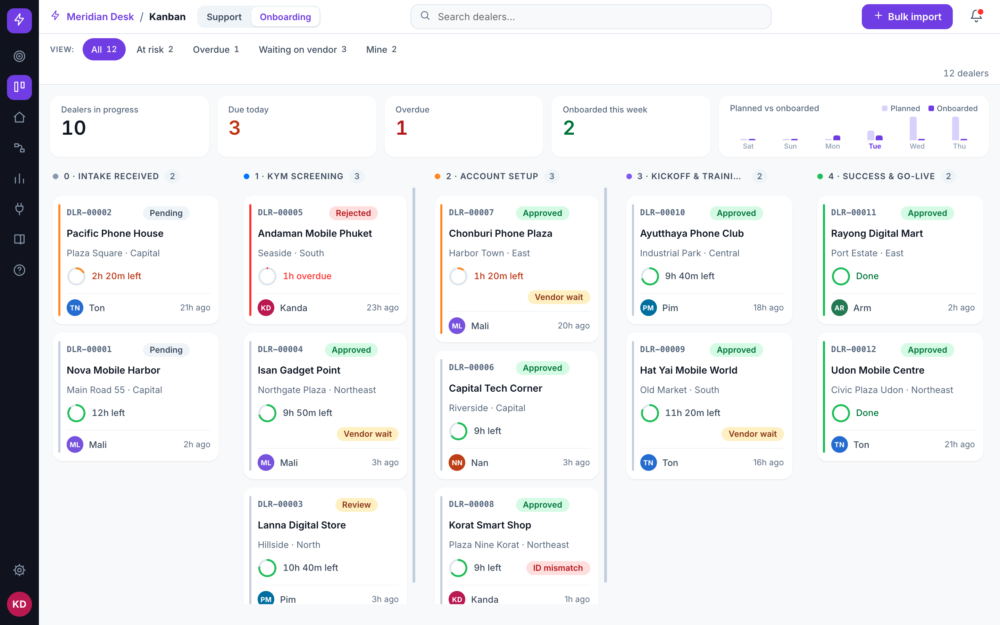
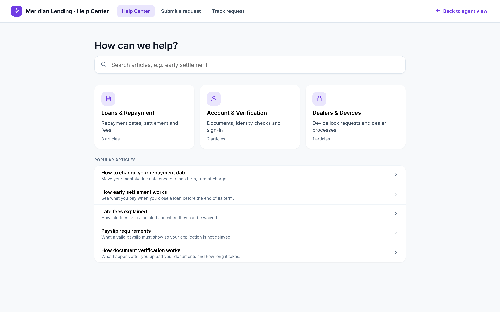

# Ops Helpdesk Prototype (UI name: Meridian Desk)

Clickable design prototype of an operations helpdesk for a fictional lender. No backend, fictional data.

**Live Demo:** [https://chatree-n.github.io/ops-helpdesk-prototype/](https://chatree-n.github.io/ops-helpdesk-prototype/)

---

## Screenshots

### Inbox


### Support Kanban


### Operations Dashboard


### Dealer Onboarding


### Customer Portal


---

## Feature Overview

### Ticketing & Queue Management
- **Unified Inbox & Kanban Board:** Switch between row-based inbox view with quick-peek side panels and a 5-column Kanban board (`New`, `Open`, `Pending`, `Escalated`, `Resolved`) with drag-and-drop or menu-based status transitions.
- **Ticket Detail & Conversation Thread:** Multi-channel conversation timeline displaying customer communications, agent responses, internal notes, rule applications, call logs, and AI-assisted summaries.
- **Bulk Actions:** Multi-select tickets in the Inbox for bulk assignments, status changes, priority reassignment, or tag updates.
- **Macros:** Canned response snippets insertable into the reply editor.
- **Collision & Time Tracking:** Simultaneous viewer detection indicator and built-in time-spent logging on tickets.

### SLA Monitoring & Policy Engine
- **Target Policies by Priority:** Dedicated SLA configurations across priority tiers (`Urgent`: 15m/4h, `High`: 1h/8h, `Normal`: 4h/24h, `Low`: 8h/72h, vendor: 24h).
- **Business Hours & Pause Conditions:** Operating clock running 08:00–22:00; pauses timers when ticket status is moved to `Pending` (when enabled in settings).
- **Live Visual Clocks:** Interactive SVG countdown SLA rings and chips with warning states (`ok`, `at-risk`, `breached`).
- **Vendor Response Tracking:** Specialized 24h response tracking timer for external hardware lock/unlock requests.

### Omnichannel Communication
- **Active Inbound Channels:** Integrated support threads for `Email`, `LINE` (Official Account), `Phone` (Cloud PBX call logs), and `Web Form`.
- **Integration Management:** Toggle channel statuses and view placeholder integrations for `Messenger`, `WhatsApp`, and `Live Chat`.
- **Outbound Webhooks:** Configurable webhook subscriptions (`ticket.created`, `ticket.resolved`, `sla.breached`) with an interactive dispatch test modal.

### Partner & Dealer Onboarding
- **5-Stage Onboarding Pipeline:** Progress dealers across `Intake`, `KYM Screening`, `Account Setup`, `Kickoff & Training`, and `Go-Live`.
- **Stage Progression Rules:** Hard guardrails enforce that moves to Stage 2 require all 5 Know-Your-Merchant (KYM) checks to pass; moves to Stage 3 require LMS and Dealer Portal IDs to be set and matching; moves to Stage 4 require a confirmed training date.
- **Hardware Lock/Unlock Requests:** Manage device lock vendor tickets and requests directly from the dealer profile.
- **Bulk CSV Import:** 3-step modal supporting CSV pasting, column preview, error validation, and batch creation.

### Knowledge Base & Self-Service Portal
- **Knowledge Base Management:** Article authoring modal with category organization, audience segregation (`Public` vs `Internal`), search filtering, and helpfulness metrics.
- **Customer Self-Service Portal:** Standalone customer-facing overlay view showing deflection articles, request submission form, and request tracking.

### Operational Analytics
- **Live Operations Dashboard:** Team Lead and Agent dashboard variants reporting open ticket volume, SLA compliance %, average first response time, average resolution time, and CSAT distribution.
- **Team Workload Breakdown:** Agent queue counts and individual SLA adherence tracking.
- **Status & Priority Distributions:** Visual workload distributions and 7-day trend charts.

### Administration & Access Control
- **Role-Based Views:** Seamless role toggle between `Agent` (focused on individual assigned queues) and `Team Lead` (unrestricted visibility across queues and edit permissions for automations, routing rules, and SLA targets).
- **Routing Rules:** Priority-ordered rule engine with condition evaluation to auto-assign teams, priority levels, and tags.
- **Guided Tour & Shortcuts:** 6-step interactive onboarding spotlight walkthrough and global keyboard shortcut navigation.

---

## How to Use the Demo

1. **Switch Roles:** Click the avatar in the lower-left navigation rail (bottom of the shell) to toggle between **Agent** and **Team Lead**.
2. **Switch Workspaces:** Use the top header tabs to toggle between the **Support** workspace (borrower/dealer issues) and the **Onboarding** workspace (dealer pipeline).
3. **Reset Demo Data:** Open the avatar menu and select **Reset demo data** at any time to restore all tickets, dealers, and timers back to their default seed state.
4. **Keyboard Shortcuts:**
   - `/` : Focus search input
   - `n` : New ticket modal (in Support workspace)
   - `g` then `i` : Go to Inbox
   - `g` then `k` : Go to Kanban
   - `g` then `d` : Go to Dashboard
   - `Esc` : Close modals, overlays, quick panels, or active tour

---

## Running Locally

Serve the directory with any local static HTTP server:

```bash
python3 -m http.server 8080
```

Then open [http://localhost:8080/](http://localhost:8080/) in your browser.

- No external network requests: the Inter font and React 18.3.1 are bundled locally.
- **Direct file access (`file://`):** Opening `index.html` directly via the file protocol is also supported.

---

## Project Structure

```text
ops-helpdesk-prototype/
├── index.html                  # Main app shell & entry point
├── HANDOFF.md                  # Developer handoff specs & token references
├── LICENSE                     # MIT License
├── README.md                   # Project documentation
├── .nojekyll                   # GitHub Pages static asset bypass
├── .gitignore                  # Git ignore rules
├── assets/
│   ├── css/
│   │   └── app.css             # Base resets & self-hosted @font-face
│   ├── fonts/
│   │   └── inter-var-latin.woff2 # Self-hosted Inter variable font
│   ├── js/
│   │   ├── dc-bundle.js        # Generated component bundle (pre-inlined)
│   │   ├── router.js           # Client-side hash router
│   │   ├── store.classic.js    # In-memory reactive state store (classic script)
│   │   └── support.js          # Component runtime engine
│   └── vendor/
│       ├── react.production.min.js     # React 18.3.1 (local)
│       └── react-dom.production.min.js # ReactDOM 18.3.1 (local)
├── docs/
│   └── screenshots/            # Showcase screenshots
├── standalone/                 # Single-file bundled versions & generator sources
├── *.dc.html                   # Component source templates (Design Components)
└── store.js                    # ES module source for reactive state store
```

> **Note on Generated Bundles:** `assets/js/store.classic.js` and `assets/js/dc-bundle.js` are generated distributions built from `store.js` and the `*.dc.html` source files.

For full architectural details, design tokens, route parameters, and guidance on connecting real backend APIs, see [HANDOFF.md](HANDOFF.md).

---

## Disclaimer

All names, identification numbers, addresses, phone numbers, contacts, and dealers featured in this project are strictly fictional. Any resemblance to real persons, living or dead, or actual businesses is purely coincidental. Product names such as LINE, Messenger, and WhatsApp are used solely for illustrative purposes; no official logos or trademarks are used. This prototype is not affiliated with, sponsored by, or endorsed by any commercial lender or service provider.

---

## Credits

- Designed and prototyped with **Claude Design** (Anthropic)
- Typography: **Inter** by Rasmus Andersson (SIL Open Font License 1.1)
- UI Library: **React 18** (MIT License)
